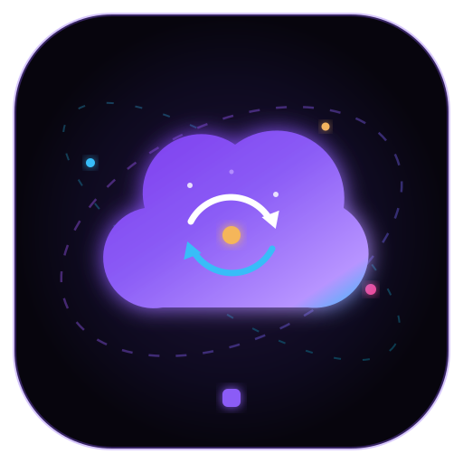
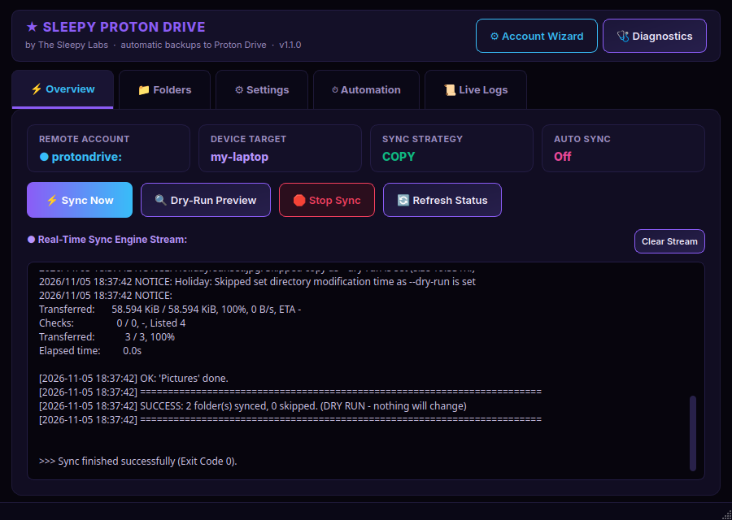

<div align="center">



# Sleepy Proton Drive

**Automatic Proton Drive backups for Linux, with a friendly app and a terminal mode.**
By [The Sleepy Labs](https://thesleepylabs.net)

[](https://github.com/TheSleepyLabs/sleepy-proton-drive/actions/workflows/ci.yml)
[](LICENSE)
[](#requirements)
[](https://rclone.org/protondrive/)

</div>

Proton has Drive apps for Windows, macOS and phones, but not for Linux.
Sleepy Proton Drive fills that gap: pick the folders you want, and it backs them up to
your Proton Drive automatically in the background. It's built on
[rclone](https://rclone.org/protondrive/), so your files stay end-to-end encrypted.

- **Setup wizard** (app or terminal): log in (2FA supported), pick folders, done.
- **Three sync modes**: `copy` (safest, the default), `sync` (mirror) and `bisync` (two-way).
- **Background sync** every 15 min to once a day, with a systemd user timer (no root needed).
- **Safety checks**: dry-run preview, and folders that are empty (for example an unplugged
  drive) are skipped in mirror/two-way mode so they can't wipe your cloud copy.
- **Exclude folders**: back up `~/Documents` but leave out `~/Documents/Old stuff`.
- **Proton Photos download**: save the photos from your phone (or uploaded by hand) to this
  computer, sorted into `Year/Month` folders, with the same three modes. Pick categories
  (videos, RAW, screenshots…) and years/months. See [Proton Photos](#proton-photos).
- **Dashboard**: Sync Now, Dry-Run, Stop, live log, folder manager, speed limits and skip rules.

> [!NOTE]
> Sleepy Proton Drive is an independent open-source project. It is **not made by or affiliated
> with Proton AG**. It uses rclone's community-maintained Proton Drive backend, which Proton
> doesn't officially support, so changes on Proton's side can occasionally break it until rclone
> is updated. Keep rclone up to date, and keep important files in more than one place.

<div align="center">

</div>

---

## Quick start

```bash
git clone https://github.com/TheSleepyLabs/sleepy-proton-drive.git
cd sleepy-proton-drive
./install.sh
```

The installer checks what you need and offers to install anything missing (rclone, and
PySide6 for the app). Then open **Sleepy Proton Drive** from your app menu, or run:

```bash
sleepy-proton-gui      # the app (opens the setup wizard the first time)
sleepy-proton-wizard   # or: set up in the terminal instead
```

The wizard asks for:

1. **Your Proton login**: email/username, password, and your 6-digit 2FA code if you use 2FA.
   Accounts with a separate mailbox password ("two-password mode") are supported.
2. **A name for this computer**: files go to `Devices/<name>/` in your Drive so several
   computers don't mix.
3. **Folders to back up**: Documents, Pictures, Desktop… or any folder you choose.
4. **Sync mode** (see below). If you're unsure, keep `copy`.
5. **Background sync**: how often to sync automatically, or off.

Tip: click **🔍 Dry-Run Preview** (or run `sleepy-proton-sync --dry-run`) before the first real
sync to see exactly what will happen.

## Requirements

| What | Why | Notes |
|---|---|---|
| Linux | | Tested on Fedora/Nobara. Should work on Ubuntu/Debian, Arch, openSUSE and others. |
| [rclone](https://rclone.org) **1.63 or newer** | Talks to Proton Drive | `./install.sh` installs it if missing. Debian/Ubuntu's packaged rclone is usually too old, so the official rclone installer is used there. |
| Bash 4.4+ | Sync engine & wizard | Included in every current distro. |
| Python 3.9+ and PySide6 | Only for the app | Installed from your distro, or into a private folder (`~/.local/share/sleepy-proton-drive/venv`) if your distro doesn't package it. The terminal tools work without it. |
| systemd (user session) | Only for background sync | Without it, sync by hand or from cron. |
| Proton's [`proton-drive`](https://proton.me/drive/download) tool | Only for Proton Photos | One click in the app's 📷 Photos tab (or `sleepy-proton-photos --install-cli`) downloads Proton's official tool to `~/.local/bin` and checks it against a known SHA-512 checksum. |
| `notify-send`, `xdg-open` | Optional | Desktop notifications and "open folder" buttons. |

Check everything at any time with `sleepy-proton-check` (or `./check-requirements.sh`), and add
`--fix` to install what's missing.

## Sync modes

| Mode | What happens | Deleting a file on this computer… |
|---|---|---|
| `copy` *(default, safest)* | New and changed files are uploaded. | …does **not** delete it in Proton Drive. |
| `sync` (mirror) | Proton Drive is made to match this computer exactly. | …**deletes it in Proton Drive** too. |
| `bisync` (two-way) | Changes on either side are copied to the other. | …deletes it in Proton Drive, and deleting in Proton deletes it here. |

The first `bisync` run of each folder sets a baseline automatically (rclone's `--resync`). In
`sync` and `bisync` mode, a folder that is completely empty is skipped, so an unmounted drive
can't wipe your backup.

## Proton Photos

The **📷 Photos** tab downloads your Proton Photos library (from the Proton Drive phone app,
or uploaded at [drive.proton.me/photos](https://drive.proton.me/photos)) to this computer.
It uses Proton's own official `proton-drive` command-line tool, because rclone can't see
Photos.

1. **Install Proton's tool** and **Sign In** (opens your browser once; the login is kept in
   your desktop's keyring).
2. Pick **where to save** them (default `~/Pictures/Proton Photos`) and a **mode**.
3. Pick **what to download**: categories, and **Load Dates & Counts from Proton** to pick
   years or months. Untick *Everything* / *All dates* to choose.
4. Click **Preview** to see what would happen, then **Download Photos Now**. Tick
   *Download automatically* to include Photos in every background sync.

Photos are saved by the date they were taken: `Proton Photos/2026/11 November/IMG_0001.jpg`.

| Mode | New photos in Proton | Delete a photo in Proton… | Delete a photo on this computer… |
|---|---|---|---|
| `copy` *(default)* | Downloaded | …it stays on this computer. | …it isn't downloaded again. |
| `sync` (mirror) | Downloaded | …it moves to this computer's trash. | …it's downloaded again. |
| `bisync` (two-way) | Downloaded | …it moves to this computer's trash. | …it moves to **Proton's trash** (restorable for 30 days). |

Safety checks: if the Photos folder is missing or empty (an unplugged drive), or if a run would
delete more than a quarter of your photos (at least 20), nothing is deleted and you get a
warning. Photos you untick in the settings are left on this computer, not deleted. Keep the
Photos folder **outside** your backed-up folders, or the photos get uploaded to Drive a second
time (the app warns you).

```bash
sleepy-proton-photos --dry-run       # preview
sleepy-proton-photos                 # download now (uses the settings above)
sleepy-proton-photos --status        # is Proton's tool installed and signed in?
sleepy-proton-photos --index-only    # refresh the counts shown in the app
sleepy-proton-photos --reset         # forget what was downloaded (files are kept)
```

## Where your files go

Each folder is stored under its own name:

```
Proton Drive (My files)
└── Devices/
    └── <computer name>/
        ├── Documents/
        ├── Pictures/
        └── …
```

Because folders are stored by name, you can't sync two folders with the same name (for example
`~/Documents` and `~/Work/Documents`). The app and the sync engine warn you if you try.

## Commands

| Command | What it does |
|---|---|
| `sleepy-proton-gui` | Open the app. `--wizard` opens the setup wizard straight away. |
| `sleepy-proton-wizard` | Set everything up in the terminal. |
| `sleepy-proton-sync` | Sync now. |
| `sleepy-proton-sync --dry-run` | Show what would change, without changing anything. |
| `sleepy-proton-sync --mode sync` | Use a different mode for this one run. |
| `sleepy-proton-sync --status` | Show the current settings and timer. |
| `sleepy-proton-sync --stop` | Stop the running sync (background or app). Files already copied are kept. |
| `sleepy-proton-sync --restart` | Stop the running sync and start a fresh one in the background. |
| `sleepy-proton-sync --running` | Print `running <PID>` or `idle`. |
| `sleepy-proton-sync --enable-timer 1h` | Turn on background sync (15min, 30min, 1h, 2h, 1d, …). |
| `sleepy-proton-sync --disable-timer` | Turn off background sync. |
| `sleepy-proton-photos` | Download Proton Photos now (see [Proton Photos](#proton-photos)). |
| `sleepy-proton-check [--fix]` | Check (and fix) requirements and your login. |
| `./uninstall.sh [--purge]` | Remove the app. `--purge` also removes settings and logs. |

Background sync uses the systemd user units `sleepy-proton-sync.timer` and `.service`:

```bash
systemctl --user list-timers sleepy-proton-sync.timer    # when is the next sync?
journalctl --user -u sleepy-proton-sync.service -f       # watch background syncs live
```

## Configuration

Settings live in `~/.config/proton-sync.conf`. The app and the wizard write it for you, but
it's a plain Bash file you can also edit by hand
(see [`config/proton-sync.conf.example`](config/proton-sync.conf.example)):

| Setting | Default | Meaning |
|---|---|---|
| `REMOTE_NAME` | `protondrive` | The rclone remote that holds your Proton login. |
| `DEVICE_NAME` | hostname | Folder name under `Devices/` in Proton Drive. |
| `SYNC_DIRS` | Documents, Pictures | Folders to back up. `$HOME` and `~` are expanded. |
| `EXCLUDE_DIRS` | none | Folders **inside** the ones above that are never backed up, e.g. `"$HOME/Documents/Old stuff"`. Only that exact folder is skipped (a folder with the same name elsewhere is still backed up). Copies already in Proton Drive are kept. Easiest from the app: **Folders → Exclude a Folder…** |
| `SYNC_MODE` | `copy` | `copy`, `sync` or `bisync`. |
| `NOTIFY` | `true` | Desktop notification after each sync. |
| `LOG_FILE` | `~/.local/share/proton-sync.log` | Where the log goes. |
| `LOG_MAX_LINES` | `5000` | The log is trimmed past this many lines. |
| `RCLONE_FLAGS` | see example | Any [rclone flags](https://rclone.org/flags/): speed (`--transfers`, `--bwlimit`), skip rules (`--exclude`), etc. |

By default, Git folders, `node_modules`, Python virtual environments, caches and half-downloaded
files are skipped, and symlinks are not followed.

## Troubleshooting

| Problem | Fix |
|---|---|
| **"Not logged in" / login stopped working** | Proton sessions can expire. Run the wizard again (app: ⚙ Account Wizard). |
| **2FA code rejected** | Codes change every 30 seconds. Type a fresh one just before clicking Log In. |
| **Login fails with a captcha or "human verification" error** | Log in once at [drive.proton.me](https://drive.proton.me) in your browser, wait a few minutes, then try again. |
| **`command not found: sleepy-proton-gui`** | `~/.local/bin` isn't in your PATH. Add `export PATH="$HOME/.local/bin:$PATH"` to `~/.bashrc`, then open a new terminal. |
| **The app doesn't open** | Run `sleepy-proton-gui` in a terminal to see why. Usually PySide6 is missing: run `sleepy-proton-check --fix`. |
| **bisync says it needs `--resync`** | rclone stopped to protect your files. Check the log, then delete the marker it names (in `~/.local/state/sleepy-proton-drive/bisync/`) and sync again. |
| **Photos: "You need to login first"** | Click **Sign In** in the 📷 Photos tab (or run `proton-drive auth login`). |
| **Photos: "SAFETY STOP"** | A run wanted to delete a lot of photos at once. Check the Photos folder is there, then either fix it or run `sleepy-proton-photos --allow-mass-delete` once. |
| **Anything else** | Check the log (app: 📜 Live Logs, or `~/.local/share/proton-sync.log`) and `sleepy-proton-check`. Still stuck? [Open an issue](https://github.com/TheSleepyLabs/sleepy-proton-drive/issues). |

## Privacy & security

- Your login goes straight from this computer to Proton, through rclone. There is **no telemetry**
  and no server in between. The only network traffic is between rclone and Proton (plus a
  reachability check to `proton.me` in `sleepy-proton-check`).
- rclone stores your login in `~/.config/rclone/rclone.conf`. Passwords there are
  [*obscured*, not encrypted](https://rclone.org/commands/rclone_obscure/), so anyone who can read
  that file can use your login. rclone makes the file readable only by you; keep it that way, and
  never share it. For extra protection you can
  [encrypt rclone's config](https://rclone.org/docs/#configuration-encryption) (background sync
  then needs the password provided another way, for example `RCLONE_CONFIG_PASS`).
- Saving your 2FA secret key is optional and off by default. It lets rclone log in again by
  itself, but it means someone with your rclone config doesn't need your phone.
- Every line of code is in this repository. Read it, and report security problems privately
  (see [SECURITY.md](SECURITY.md)).

## Uninstall

```bash
./uninstall.sh            # remove the app, keep your settings
./uninstall.sh --purge    # also remove settings, logs and saved state
rclone config delete protondrive   # optional: remove your saved Proton login
```

Your files in Proton Drive and on this computer are never deleted by uninstalling.

## Contributing

Bug reports and pull requests are welcome. See [CONTRIBUTING.md](CONTRIBUTING.md).
`tests/smoke-test.sh` tests the sync engine against a fake local "Proton Drive", so you don't
need an account to work on it.

## License

[MIT](LICENSE) © 2026 The Sleepy Labs
